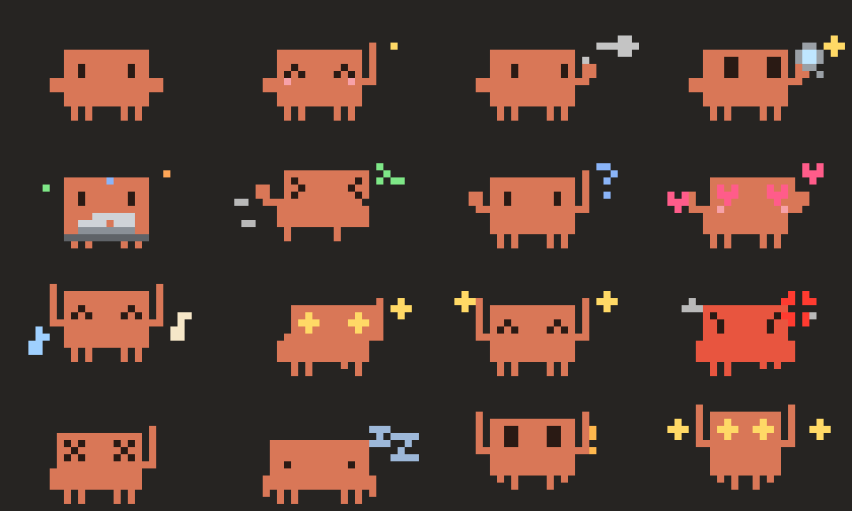

# Dancing Claude

Clawd, the Claude Code critter, lives just above your prompt and reacts to what Claude is doing. It paces while Claude thinks, types on a laptop during edits, squints through a magnifier during reads, takes notes while you type, and dances when a turn finishes.



## Install

In Claude Code:

```
/plugin marketplace add nyad-dev/dancing-claude
/plugin install dancing-claude@dancing-claude
```

Or from a shell:

```powershell
irm https://raw.githubusercontent.com/nyad-dev/dancing-claude/main/install.ps1 | iex   # Windows
```
```bash
curl -fsSL https://raw.githubusercontent.com/nyad-dev/dancing-claude/main/install.sh | bash   # macOS / Linux
```

Then start a new session. It costs **zero tokens**: nothing is added to Claude's context, and `/clawd` answers with a toast.

## Use

```
/clawd                     show / hide
/clawd dance               or happy, love, angry, sleep, code, notes, party, wave…
/clawd tiny|small|big      4 rows (default), 7 rows, 14 rows
/clawd left|center|right   where Clawd hangs out
```

## Try it without Claude Code

```bash
node cli/dance.ts [mood] [--tiny|--big]     # needs Node 22.18+
```

## Develop

`claude --plugin-dir ./plugin` loads your working copy, which hot-reloads on save. `npm test` validates the plugin and runs its tests. `node tools/sheet.ts out.png [mood]` renders every animation frame for review. Art and moods live in `plugin/hooks/clawd.ts`, and the wiring from events to moods is in `plugin/hooks/register.tsx`.

---

Unofficial fan project. Clawd belongs to Anthropic.
